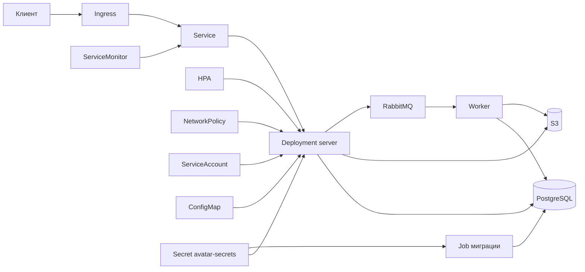

# Avatars service

Сервис хранит аватарки пользователей: загрузка через API и веб-форму, выдача файла и метаданных, обработка миниатюр через RabbitMQ.

## Локальный запуск

Нужны Docker и Docker Compose.

```bash
cp .env.example .env
docker compose up --build
```

В `.env` задаются `POSTGRES_PASSWORD`, `RABBITMQ_USER`, `RABBITMQ_PASSWORD`, `MINIO_ROOT_PASSWORD`. Для входа в Grafana compose читает `GF_SECURITY_ADMIN_PASSWORD`.

После старта:

- API и веб: http://localhost:8080
- форма загрузки: http://localhost:8080/web/upload
- проверка зависимостей: http://localhost:8080/health
- метрики: http://localhost:8080/metrics
- Prometheus: http://localhost:9090
- Grafana: http://localhost:3000
- Jaeger: http://localhost:16686

Сервер и воркер берут настройки из переменных окружения: `SERVER_HTTP_ADDRESS`, `DATABASE_DSN`, `LOG_LEVEL`, `S3_ENDPOINT`, `S3_REGION`, `S3_BUCKET`, `S3_ACCESS_KEY`, `S3_SECRET_KEY`, `S3_PATH_STYLE`, `RABBITMQ_URL`. В compose они уже прописаны.

Спецификация API: `api/v1/openapi.yaml`. HTML-версия:

```bash
make api-build
```

Файл появится в `api/v1/openapi.html`.

## Тестирование

Из корня репозитория. Цель проверяет, что фоновая горутина завершается после сигнала остановки, а не остаётся висеть.

- `TestCollectRuntimeMetricsExits` — `CollectRuntimeMetrics` выходит после отмены контекста.
- `TestWatchQueueDepthExits` — `WatchQueueDepth` выходит после закрытия канала `stop`.
- `TestRunGoroutinesExit` — оба слушателя очередей и relay в `Worker.Run` выходят после отмены контекста.
- `TestListenGoroutineExits` — горутина `ListenAndServe` внутри `Servers.Start` выходит после отмены контекста, `Start` возвращается без ошибки.

Первые три теста запускает `testing/synctest` из стандартной библиотеки. Если после сигнала горутина всё ещё заблокирована, тест падает по дедлоку. Приём HTTP проверяется на локальном порту: `Start` должен вернуться не позже чем через 2 секунды.

```bash
make test-goroutines
```

В выводе три строки `ok`, по одной на пакет. Строки `[no tests to run]` быть не должно.

## Деплой в Kubernetes

Чарт лежит в `avatar-service/`. Ниже порядок, в котором его ставят в кластер. Локальный `docker compose` останавливать не нужно: он занимает порты на вашей машине, чарт поднимает поды внутри кластера.

Заранее нужны `kubectl`, `helm` и кластер Rancher Desktop, контекст `rancher-desktop`. Вход снаружи делает Traefik в namespace `kube-system`. Postgres, MinIO и RabbitMQ поднимает шаг 5.

### 1. Проверить кластер

```bash
kubectl config current-context
kubectl get nodes
```

Первая команда печатает имя текущего кластера. Вторая должна показать ноды в статусе `Ready`. Если контекст не тот: `kubectl config use-context ИМЯ`.

### 2. Создать namespace и переключить на него текущий контекст

Namespace — отдельное место в кластере для этого сервиса. Дальше команды идут в `avatars`:

```bash
kubectl create namespace avatars
kubectl config set-context --current --namespace=avatars
```

### 3. Пометить namespace ingress

Чарт ставит NetworkPolicy. Она смотрит на метку namespace, а не на его имя. Входящий трафик пускает только оттуда, где стоит метка `name=ingress-nginx`.

В этом кластере Traefik работает в `kube-system`. Метку ставят на него:

```bash
kubectl label namespace kube-system name=ingress-nginx
kubectl get namespace kube-system --show-labels
```

В списке меток должна быть `name=ingress-nginx`.

Исходящий трафик пускает в namespace с метками `name=database`, `name=s3` и `name=rabbitmq`. DNS идёт в `kube-system` на порт 53 по TCP и UDP. Селектор DNS — `kubernetes.io/metadata.name=kube-system`: эту метку Kubernetes ставит сам. Метку `name` на `kube-system` ради DNS не меняют, она уже равна `ingress-nginx`.

Postgres, MinIO и RabbitMQ в этом деплое запускает `docker compose` на хосте, отдельных namespace для них нет. Политика дополнительно открывает наружу TCP-порты 5432, 5672 и 9000. Метки `name=database`, `name=s3` и `name=rabbitmq` на этом шаге не ставят.

### 4. Собрать образ

Из корня репозитория:

```bash
docker build -t avatar-service:0.1.0 .
```

Чарт берёт образ `avatar-service:0.1.0` (`image.pullPolicy: IfNotPresent`). В `values.yaml` поле `image.tag` пустое, поэтому Deployment подставляет `appVersion` из `Chart.yaml`, сейчас это `0.1.0`. `docker build` собирает образ в OrbStack. Кластер читает контекст `rancher-desktop`, поэтому образ загружают туда.

```bash
docker save avatar-service:0.1.0 | docker --context rancher-desktop load
docker --context rancher-desktop tag avatar-service:0.1.0 docker.io/library/avatar-service:0.1.0
```

Команда `tag` ничего не печатает. Дальше проверьте, что в Docker кластера лежит именно эта сборка и что Kubernetes найдёт её по полному имени:

```bash
docker --context rancher-desktop images avatar-service
docker image inspect avatar-service:0.1.0 --format 'created={{.Created}}'
docker --context rancher-desktop image inspect avatar-service:0.1.0 --format 'created={{.Created}} id={{.Id}}'
docker --context rancher-desktop image inspect docker.io/library/avatar-service:0.1.0 --format 'id={{.Id}}'
```

Первая команда смотрит список образов в `rancher-desktop`. В нём одна строка `avatar-service:0.1.0`. Второй строки нет: для этого Docker короткое имя уже значит `docker.io/library/avatar-service:0.1.0`.

Вторая команда берёт время сборки в OrbStack, третья — время того же тега в `rancher-desktop`. Значения `created` совпадают: в кластер попал только что собранный образ. Поля `id` у двух Docker разные, их не сравнивают.

Четвёртая команда открывает полное имя, которое запрашивает Kubernetes. Её `id` совпадает с `id` из третьей команды. Под возьмёт загруженный образ и не пойдёт за ним на Docker Hub.

### 5. Поднять зависимости и положить адреса в секрет

Postgres, MinIO и RabbitMQ для этого деплоя запускает `docker compose`. Из виртуальной машины Rancher Desktop Mac виден как `host.rancher-desktop.internal`. Пароли берутся из `.env` в корне репозитория. Если файла ещё нет: `cp .env.example .env`.

```bash
docker compose up -d --wait postgres minio rabbitmq
```

Секрет читают job миграции и Deployment. В нём четыре ключа. Адрес MinIO, регион и имя бакета в секрет не входят: они заданы в `values-dev.yaml`. Пользователь базы `developer`, имя базы `avatars`.

| Ключ | Откуда | Куда попадает |
|---|---|---|
| `database-url` | строка Postgres | сервер читает её как `DATABASE_DSN`, job миграции — как `DATABASE_URL` |
| `s3-access-key` | пользователь MinIO, `minio` | `S3_ACCESS_KEY` |
| `s3-secret-key` | `MINIO_ROOT_PASSWORD` из `.env` | `S3_SECRET_KEY` |
| `rabbitmq-url` | адрес RabbitMQ с логином и паролем из `.env` | `RABBITMQ_URL` |

```bash
kubectl create secret generic avatar-secrets \
  --from-literal=database-url="postgres://developer:$(grep '^POSTGRES_PASSWORD=' .env | cut -d= -f2-)@host.rancher-desktop.internal:5432/avatars?sslmode=disable" \
  --from-literal=s3-access-key=minio \
  --from-literal=s3-secret-key="$(grep '^MINIO_ROOT_PASSWORD=' .env | cut -d= -f2-)" \
  --from-literal=rabbitmq-url="amqp://$(grep '^RABBITMQ_USER=' .env | cut -d= -f2-):$(grep '^RABBITMQ_PASSWORD=' .env | cut -d= -f2-)@host.rancher-desktop.internal:5672/"
```

Секрет попадает в текущий namespace, то есть в `avatars`.

```bash
kubectl get secret avatar-secrets
```

В колонке `DATA` должно быть `4`: `database-url`, `s3-access-key`, `s3-secret-key`, `rabbitmq-url`.

### 6. Установить чарт

На этом шаге выполняются четыре команды ниже, по порядку. Файл `values-prod.yaml` в них не входит.

Кластер версии 1.37. Ограничения пода задаёт `securityContext`: процесс идёт от пользователя 65534, без лишних capabilities. Шаблон PodSecurityPolicy на время установки убирают из каталога шаблонов и возвращают после Helm.

Первая команда ставит CRD ServiceMonitor. Дальше Helm ставит dev. HPA держит от 2 до 10 реплик и целится в 70% CPU и 80% памяти. Хост Ingress — `avatars.dev.example.com`. Перед подами Helm запускает job `avatar-service-migrate` и накатывает SQL из `avatar-service/migrations/`.

```bash
kubectl apply -f avatar-service/crds/servicemonitor.yaml
mv avatar-service/templates/podsecuritypolicy.yaml /tmp/podsecuritypolicy.yaml
helm upgrade --install avatar-service ./avatar-service -f avatar-service/values-dev.yaml
mv /tmp/podsecuritypolicy.yaml avatar-service/templates/podsecuritypolicy.yaml
```

Дождитесь окончания третьей команды. В конце её вывода должно быть `STATUS: deployed`.

Сразу после этого проверьте, что релиз создал ресурсы и чем закончились миграция и под:

```bash
kubectl get pods,svc,ingress
kubectl get events --sort-by='.lastTimestamp'
kubectl logs -l app=avatar-service --tail=20
```

Service `avatar-service` и Ingress `avatar-service` с хостом `avatars.dev.example.com` должны быть в списке. В событиях у job `avatar-service-migrate` есть `Job completed`. Самого job в `kubectl get jobs` уже нет: после успеха Helm его удаляет.

Под сервера в статусе `Running`. HPA поднимает вторую реплику, у каждой `READY` `1/1`. В логе есть `starting HTTP server`. Чарт передаёт серверу `DATABASE_DSN` из ключа `database-url`. В job миграции переменная называется `DATABASE_URL`. `S3_ENDPOINT`, `S3_REGION` и `S3_BUCKET` приходят из values (для dev это `http://host.rancher-desktop.internal:9000`, `us-east-1`, `avatars`). ConfigMap `avatar-config` хранит `max_file_size`, `allowed_mime_types` и `s3_bucket`. `S3_ACCESS_KEY`, `S3_SECRET_KEY` и `RABBITMQ_URL` приходят из секрета. `S3_PATH_STYLE` не задаётся: у процесса значение по умолчанию `true`, его ждёт MinIO.

### 7. Проверить, что поднялось

```bash
kubectl get pods,svc,ingress,hpa,servicemonitor,configmap
```

Так и должно быть:

- два пода `avatar-service-...` в статусе `Running`, колонка `READY` — `1/1`;
- Service `avatar-service`, тип `ClusterIP`, порт `80`;
- Ingress `avatar-service`, класс `traefik`, хост `avatars.dev.example.com`;
- HPA `avatar-service`, минимум 2 реплики, максимум 10, цели 70% CPU и 80% памяти;
- ServiceMonitor `avatar-service`, порт `metrics`, интервал 30s;
- ConfigMap `avatar-config` с ключами `max_file_size`, `allowed_mime_types`, `s3_bucket`.

Job `avatar-service-migrate` в списке нет: миграция прошла, и Helm удалил job.

Проверка с хоста. Traefik слушает localhost, хост берётся из values:

```bash
curl -fsS --resolve avatars.dev.example.com:80:127.0.0.1 http://avatars.dev.example.com/health
```

Ответ со статусом HTTP 200. В JSON поле `status` равно `ok`, компоненты `database`, `s3` и `broker` равны `up`.

### Зависимости рядом с чартом

PostgreSQL, MinIO и RabbitMQ поднимает `docker compose` на шаге 5. Из подов они видны как `host.rancher-desktop.internal`. Воркер миниатюр тоже запускает compose:

```bash
docker compose up -d worker
```

Снаружи сайт открывается по хосту из values, когда DNS или `/etc/hosts` указывает на ingress-контроллер.

## Снять деплой

Эти команды убирают релиз из кластера. Сначала Helm, пока namespace ещё есть.

```bash
helm uninstall avatar-service -n avatars
kubectl delete namespace avatars
kubectl config set-context --current --namespace=default
kubectl label namespace kube-system name-
docker compose stop postgres minio rabbitmq
```

После этого контекст `default`, namespace `avatars` нет, метки `name=ingress-nginx` на `kube-system` нет. Postgres, MinIO и RabbitMQ остановлены. Образ в Docker Rancher Desktop эти команды не удаляют.

## Остановка

Kubernetes и `docker compose stop` посылают процессу SIGTERM. То же делает Ctrl+C локально.

Сервер перестаёт принимать новые соединения и ждёт уже идущие запросы до 5 секунд (`http.Server.Shutdown`). Затем закрываются пул PostgreSQL, соединение с RabbitMQ и экспортёры трассировок и логов.

Воркер по SIGTERM выходит из чтения очередей. Сообщение, которое не успело обработаться, возвращается в RabbitMQ.

## Архитектура



Чарт создаёт Ingress, Service, Deployment сервера, ServiceAccount, ConfigMap, NetworkPolicy, HPA и ServiceMonitor. Job миграции запускается до подов и после успеха удаляется. HPA в dev и prod включён: от 2 до 10 реплик, 70% CPU и 80% памяти. ServiceMonitor выбирает Service по метке приложения и читает порт `metrics` раз в 30 секунд. Под работает от пользователя 65534, ServiceAccount без токена API, права задаёт RBAC.

Postgres, MinIO, RabbitMQ и воркер запускает `docker compose`. Из подов они видны как `host.rancher-desktop.internal`. NetworkPolicy пускает исходящий трафик в namespace с метками `name=database`, `name=s3` и `name=rabbitmq`, DNS в `kube-system` на порт 53 и TCP-порты 5432, 5672, 9000 на адреса вне кластера.

Локальный Prometheus из compose читает метрики с `server:8080`. В кластере тот же эндпоинт отдаёт Service на порту `metrics`, его описывает ServiceMonitor.
