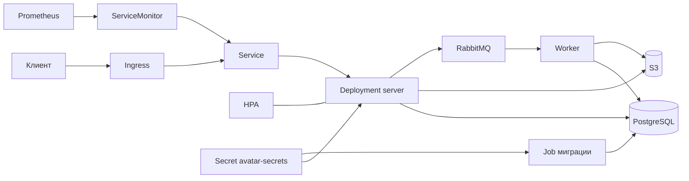

# Avatars service

Сервис хранит аватарки пользователей: загрузка через API и веб-форму, выдача файла и метаданных, обработка миниатюр через RabbitMQ.

## Локальный запуск

Нужны Docker и Docker Compose.

```bash
cp .env.example .env
docker compose up --build
```

В `.env` задаются `POSTGRES_PASSWORD`, `RABBITMQ_USER`, `RABBITMQ_PASSWORD`, `MINIO_ROOT_PASSWORD`. Для входа в Grafana compose читает `GF_SECURITY_ADMIN_PASSWORD`.

После старта:

- API и веб: http://localhost:8080
- форма загрузки: http://localhost:8080/web/upload
- проверка зависимостей: http://localhost:8080/health
- метрики: http://localhost:8080/metrics
- Prometheus: http://localhost:9090
- Grafana: http://localhost:3000
- Jaeger: http://localhost:16686

Сервер и воркер берут настройки из переменных окружения: `SERVER_HTTP_ADDRESS`, `DATABASE_DSN`, `LOG_LEVEL`, `S3_ENDPOINT`, `S3_REGION`, `S3_BUCKET`, `S3_ACCESS_KEY`, `S3_SECRET_KEY`, `S3_PATH_STYLE`, `RABBITMQ_URL`. В compose они уже прописаны.

Спецификация API: `api/v1/openapi.yaml`. HTML-версия:

```bash
make api-build
```

Файл появится в `api/v1/openapi.html`.

## Деплой в Kubernetes

Чарт лежит в `avatar-service/`. Ниже порядок, в котором его ставят в кластер. Локальный `docker compose` останавливать не нужно: он занимает порты на вашей машине, чарт поднимает поды внутри кластера.

Заранее нужны `kubectl`, `helm` и кластер Rancher Desktop, контекст `rancher-desktop`. PostgreSQL чарт не поднимает, и в этом кластере базы нет. Вход снаружи уже делает Traefik в namespace `kube-system`.

### 1. Проверить кластер

```bash
kubectl config current-context
kubectl get nodes
```

Первая команда печатает имя текущего кластера. Вторая должна показать ноды в статусе `Ready`. Если контекст не тот: `kubectl config use-context ИМЯ`.

### 2. Создать namespace

Namespace — отдельное место в кластере для этого сервиса. Дальше команды идут в `avatars`:

```bash
kubectl create namespace avatars
kubectl config set-context --current --namespace=avatars
```

### 3. Пометить namespace ingress

Чарт ставит NetworkPolicy. Она смотрит на метку namespace, а не на его имя. Входящий трафик пускает только оттуда, где стоит метка `name=ingress-nginx`. Исходящий — только туда, где стоит метка `name=database`.

В этом кластере Traefik работает в `kube-system`. Метку ставят на него:

```bash
kubectl label namespace kube-system name=ingress-nginx
kubectl get namespace kube-system --show-labels
```

В списке меток должна быть `name=ingress-nginx`.

Метку `name=database` на этом шаге не ставят: PostgreSQL в кластере нет, отдельного namespace для базы тоже. Её ставят позже на тот namespace, где база будет запущена. Локальный Postgres из `docker compose` сюда не относится.

### 4. Собрать образ

Из корня репозитория:

```bash
docker build -t avatar-service:latest .
```

Чарт берёт образ `avatar-service:latest` и не скачивает его из интернета (`image.pullPolicy: IfNotPresent`). `docker build` собирает образ в текущем контексте Docker, сейчас это OrbStack. Кластер читает другой контекст, `rancher-desktop`. Без `--context rancher-desktop` загрузка попадает обратно в OrbStack, и под образ не видит.

```bash
docker save avatar-service:latest | docker --context rancher-desktop load
docker --context rancher-desktop tag avatar-service:latest docker.io/library/avatar-service:latest
```

Проверка: `docker --context rancher-desktop images avatar-service` показывает теги `latest` и образ `docker.io/library/avatar-service`. Второе имя нужно, потому что Kubernetes запрашивает именно его.

### 5. Положить адрес базы в секрет

База для этого деплоя — Postgres из `docker compose`. В кластере её нет. Поднимите только этот контейнер:

```bash
docker compose up -d postgres
```

Секрет хранит строку подключения. Его читают job миграции и Deployment, ключ называется `database-url`. Из виртуальной машины Rancher Desktop Mac виден как `host.rancher-desktop.internal`. Пользователь базы `developer`, имя базы `avatars`, пароль берётся из `POSTGRES_PASSWORD` в `.env`.

```bash
kubectl create secret generic avatar-secrets \
  --from-literal=database-url="postgres://developer:$(grep '^POSTGRES_PASSWORD=' .env | cut -d= -f2-)@host.rancher-desktop.internal:5432/avatars?sslmode=disable"
```

Секрет попадает в текущий namespace, то есть в `avatars`. Проверка: `kubectl get secret avatar-secrets`.

### 6. Установить чарт

На этом шаге выполняются три команды ниже, по порядку, и больше ничего. Файл `values-prod.yaml` в них не входит.

Кластер здесь версии 1.37. В чарте есть шаблон PodSecurityPolicy, а с Kubernetes 1.25 такого ресурса нет, поэтому `helm` с этим файлом падает. Ограничения уже записаны в `securityContext` деплоймента. Первая команда убирает шаблон на время установки, третья кладёт его обратно в репозиторий. На уже поставленный релиз третья команда не влияет.

Вторая команда ставит dev: одна реплика, без автомасштабирования, хост `avatars.dev.example.com`. Перед подами Helm сам запускает job `avatar-service-migrate` и накатывает SQL из `avatar-service/migrations/`. ServiceMonitor в этом деплое выключен: в кластере нет CRD `monitoring.coreos.com`, отдельной команды для него нет.

```bash
mv avatar-service/templates/podsecuritypolicy.yaml /tmp/podsecuritypolicy.yaml
helm upgrade --install avatar-service ./avatar-service -f avatar-service/values-dev.yaml
mv /tmp/podsecuritypolicy.yaml avatar-service/templates/podsecuritypolicy.yaml
```

Дождитесь окончания второй команды. В конце её вывода должно быть `STATUS: deployed`.

Сразу после этого проверьте, что релиз создал ресурсы и чем закончились миграция и под:

```bash
kubectl get pods,svc,ingress
kubectl get events --sort-by='.lastTimestamp'
kubectl logs -l app=avatar-service --tail=20
```

Service `avatar-service` и Ingress `avatar-service` с хостом `avatars.dev.example.com` должны быть в списке. В событиях у job `avatar-service-migrate` есть `Job completed`. Самого job в `kubectl get jobs` уже нет: после успеха Helm его удаляет.

Под сервера при этом не `Ready`. В логе строка `configuration validation: database.dsn is required`, статус пода `CrashLoopBackOff`. Процесс читает `DATABASE_DSN`, а чарт передаёт только `DATABASE_URL`. На шаге 7 под таким остаётся.

### 7. Проверить, что поднялось

```bash
kubectl get pods,svc,ingress
```

Так и должно быть:

- под `avatar-service-...` в статусе `CrashLoopBackOff`, колонка `READY` — `0/1`;
- Service `avatar-service`, тип `ClusterIP`, порт `80`;
- Ingress `avatar-service`, класс `traefik`, хост `avatars.dev.example.com`.

Job `avatar-service-migrate` в списке нет. `kubectl logs job/avatar-service-migrate` отвечает `NotFound`: миграция прошла, и Helm удалил job. Это не ошибка шага.

`/health` по этому адресу не открывается. Процесс в поде падает на строке `database.dsn is required` из шага 6.

### Чего чарт не делает

Сервер читает `DATABASE_DSN`, а в Deployment записана `DATABASE_URL`. Миграция с `DATABASE_URL` проходит, процесс к базе не подключается. В `avatar-service/templates/deployment.yaml` у контейнера сервера переменная должна называться `DATABASE_DSN`. В job миграции оставьте `DATABASE_URL`: программа `migrate` ждёт именно её.

S3 и RabbitMQ чарт не ставит и переменные для них не передаёт. Загрузка и миниатюры без них не работают. В контейнер нужны те же переменные, что в `docker-compose.yml`: `S3_ENDPOINT`, `S3_REGION`, `S3_BUCKET`, `S3_ACCESS_KEY`, `S3_SECRET_KEY`, `S3_PATH_STYLE`, `RABBITMQ_URL`. Воркер очереди в чарт тоже не входит. Локально его поднимает `docker compose`.

Исходящая NetworkPolicy сервера пускает трафик только в namespace базы. С переменными поды всё равно не дойдут до S3, RabbitMQ и до DNS в `kube-system`. В политику нужно добавить эти namespace и порт 53.

Снаружи сайт откроется по хосту из values, когда DNS или `/etc/hosts` указывает на ingress-контроллер.

## Остановка

Kubernetes и `docker compose stop` посылают процессу SIGTERM. То же делает Ctrl+C локально.

Сервер перестаёт принимать новые соединения и ждёт уже идущие запросы до 5 секунд (`http.Server.Shutdown`). Затем закрываются пул PostgreSQL, соединение с RabbitMQ и экспортёры трассировок и логов.

Воркер по SIGTERM выходит из чтения очередей. Сообщение, которое не успело обработаться, возвращается в RabbitMQ.

## Архитектура



В кластере из чарта поднимаются Ingress, Service, Deployment сервера, HPA, ServiceAccount, NetworkPolicy, ServiceMonitor, PodSecurityPolicy с RBAC и Job миграции. PostgreSQL ожидается в отдельном namespace. Воркер, S3 и RabbitMQ в чарт не входят: локально их поднимает `docker compose`. ServiceMonitor указывает Prometheus на порт `metrics` сервиса.
